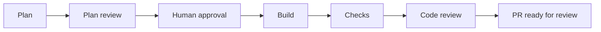

# ben

Claude builds. Codex reviews the plan and code. You approve the plan;
scripted checks and independent review control progress.



Failed checks or review findings require repair or a human decision. Changed
plans require renewed approval. Evidence stays in the target's `.ben/` directory.
**Ben never merges or deploys.**

## Quickstart

Follow the [quickstart](GETTING_STARTED.md) to install the skill and run a small
supervised task. Live features require your own authenticated Claude and Codex
access; usage may incur charges. Publication also requires GitHub access.

Try the scripted offline demo with Git and Node.js 24:

```bash
node examples/offline/run.mjs
```

Expected: two failed implementations, then a passing repair and an evidence path.
No AI calls, credentials, dependencies or remote writes; commits stay in a
temporary fixture. The demo cannot build a new feature.

## Development

Requires Git, Node.js 24 and Bun 1.3.14. The runner and full suite require macOS.

```bash
bun install --frozen-lockfile
PLAYWRIGHT_BROWSERS_PATH="$PWD/.playwright-browsers" ./node_modules/.bin/playwright install chromium
bun run typecheck
bun run test
```

Tests use scripted agents. See [verification](VERIFICATION.md) for environment
requirements, separate examples and recorded results.

| Interface | Status |
| --- | --- |
| `SKILL.md`, `references/`, `prompts/`, `schemas/`, `scripts/*.mjs` | Active runtime; Node built-ins only |
| `src/`, `config/ben.config.ts`, `bun run ben` | Retired, tested legacy code; different approval and review behavior |

## Status

Experimental, single-operator macOS tooling. Bounded live acceptance passed with
human intervention. Beyond-soft-cap live continuation remains an accepted,
unexercised gap. Checks can miss defects; estimates are not spending ceilings.
See [live verification](VERIFICATION.md#live-acceptance-and-release-decision)
and [known limitations](FINDINGS.md).

The [CSV example](examples/csv-export/PROVENANCE.md) records an interactive happy
path: 17 tests, six criteria, human approval, and Codex GO on plan and diff.
It is not autonomous-runner or defect-repair acceptance; formula protection was
out of scope.

## Documentation

[Quickstart](GETTING_STARTED.md) · [Skill](SKILL.md) ·
[Runner](references/runner.md) · [Recovery](references/recovery.md) ·
[Design](DESIGN.md) · [Quality bar](NORTH_STAR.md) · [Roadmap](ROADMAP.md)

MIT licensed.
