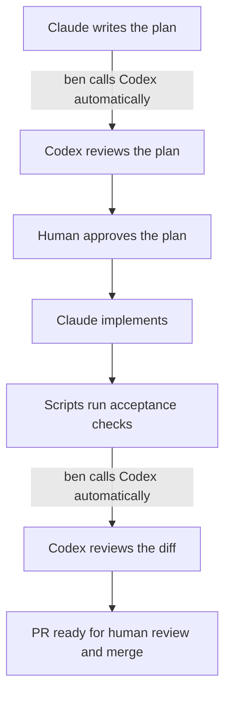

# ben

Claude builds; ben automatically calls Codex to review the plan and code.
Independent review, human approval, and scripted checks control progress.



The diagram shows the successful path. Failed checks and review findings require
repair or a human decision. Plans, approvals, findings, and evidence stay in the
target repository's `.ben/` directory. Changed plans require renewed approval.
ben never merges or deploys.

## Worked example

Claude built a synthetic CSV export that preserves filters and excludes
internal notes. Codex returned GO on the plan and diff with zero blockers; a human
approved the plan. All 17 tests passed across six criteria.

Inspect the [original code, tests and review provenance](examples/csv-export/PROVENANCE.md).
This operator-run example demonstrates the interactive happy path, not autonomous
runner acceptance or defect repair. Formula protection was out of scope.

## Try it locally

From a checkout of ben, with Git and Node.js 24, run the free example:

```bash
node examples/offline/run.mjs
```

It deliberately fails two implementations, parks for a simulated operator decision,
then repairs the code. Inspect the printed evidence directory. No model credentials,
dependencies, browser or remote writes are needed; commits stay in a temporary fixture.

## Development

Requires Git, Node.js 24, and Bun 1.3.14. The runner and full test suite require macOS.

```bash
bun install --frozen-lockfile
PLAYWRIGHT_BROWSERS_PATH="$PWD/.playwright-browsers" ./node_modules/.bin/playwright install chromium
bun run typecheck
bun run test
```

Tests use scripted agents; no model credentials are required. See
[verification](VERIFICATION.md) for environment requirements and results.

## Use

Live use requires authenticated Claude and Codex CLIs. GitHub publication
requires authenticated `gh` and Git push access. Model calls may incur charges.

From the ben checkout, link the skill once (leave an existing `ben` skill untouched):

```bash
mkdir -p "$HOME/.claude/skills"
if [ ! -e "$HOME/.claude/skills/ben" ] && [ ! -L "$HOME/.claude/skills/ben" ]; then
  ln -s "$PWD" "$HOME/.claude/skills/ben"
fi
```

Open Claude in a target Git repository and say “build it through ben,” then
describe the change. The [skill reference](SKILL.md) covers planning, approvals,
recovery, and the optional macOS runner. Runner assignments include branch push
and PR creation; use them only when that publication is intended.

The runtime is `SKILL.md`, `references/`, `prompts/`, `schemas/`, and `scripts/*.mjs` (Node built-ins only). `src/`,
`config/ben.config.ts`, and `bun run ben` are retired, retained as a tested legacy
implementation. Its approval, manual-criterion and
review-input behavior differs from the active scripts; use the skill interface
for current workflows.

## Limits

Experimental, single-operator macOS tooling. Bounded live acceptance passed with
human intervention; beyond-soft-cap continuation remains unexercised and is an
accepted release gap. See [verification](VERIFICATION.md#live-acceptance-and-release-decision).
Checks can miss defects; cost estimates are not spending ceilings.

Local check results and their scope are recorded in [verification](VERIFICATION.md).

[Design](DESIGN.md) · [Quality bar](NORTH_STAR.md) · [Roadmap](ROADMAP.md) ·
[Known limitations](FINDINGS.md). MIT licensed.
