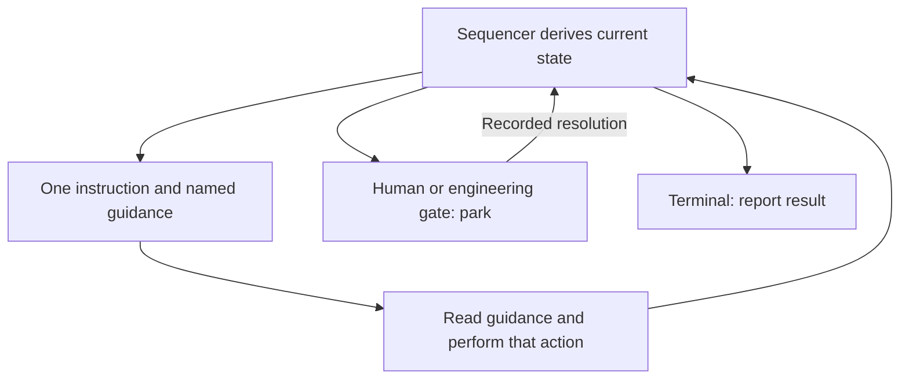

# ben

Claude builds; ben calls Codex for independent review. Scripts own sequencing,
checks and durable records. A model's completion report is never verification.

## Control loop



The diagram explains control, not a phase order to execute from memory.
Every reference returns to the controller; none authorizes the next stage.

## Read only the applicable reference

| When | Reference |
| --- | --- |
| Start, clarify intake, adopt or move task state | [Start](references/start.md) |
| Write or repair plan artifacts | [Plan](references/plan.md) |
| Evaluate blockers and prepare proposals/resolutions | [Reconcile](references/reconcile.md) |
| Present or record an actual human decision | [Decisions](references/decisions.md) |
| Implement, fix checks or prepare reviewed code | [Verification](references/verification.md) |
| Authorized PR publication or remote reconciliation | [Publication](references/publication.md) |
| Operate the runner, service or optional Stop hook | [Runner](references/runner.md) |
| A diagnosed STOP needs engineering recovery | [Recovery](references/recovery.md) |

`next` names the required work reference from its own runtime. Read it before
acting. The runner supplies that reference directly to each headless stretch.
Missing required guidance is an installation error, never permission to guess.

## Roles and commands

`$BEN` is this installed skill directory; `$S` is the target repository's `.ben/`.
Keep one state directory per task and preserve its evidence. The retired `src/`
CLI uses different state and rules; do not mix it with this workflow.

Run sequencer commands from the target repository root, with `BEN` set to the
absolute path of the installed ben checkout. Commands that must run from the ben
checkout say so explicitly. In command templates, replace `<...>` placeholders
with actual values (quote values containing spaces); do not type the angle
brackets. Square brackets mark optional arguments, and `|` separates alternatives;
neither notation is literal shell syntax. Use the exact commands printed by a
current gate when answering it.

**Interactive coordinator:** read Start before initializing. Clarify consequential
ambiguity, ignore `.ben/` before the baseline commit, and make the e2e/configuration
decisions explicitly. To resume existing work:

```bash
node "$BEN/scripts/run.mjs" next
```

Perform exactly the returned instruction and repeat. Never select a later phase.
Exit **0** means advancement or an instruction; **1** means model repair work;
**2** means a park/STOP—inspect `status` for its owner; **3** means invalid usage.
Model-owned follow-up remains your work. A current human/playbook gate ends the
stretch: present the generated `.ben/WAITING.md` brief and wait for its resolution.
Use the gate's exact answer commands; never invent a human answer.

**Headless driver:** perform only the runner's current instruction and supplied
guidance, then return a short report. Never call `next`, `record-*`, `answer`,
`init` or `adopt`; never push or call `gh`. The runner owns continuation.
For consequential ambiguity during planning, write `.ben/questions.json` as
`[{"id":"…","question":"…"}]`; the runner presents the human gate.

## Rules that always apply

- Let scripts judge artifacts, scope, checks and reviews. Do not simulate checks,
  skip them, construct verdicts or replace raw failure evidence with a summary.
- Implementation requires current recorded human approval. Changed plan inputs
  or relevant configuration require renewed approval through the sequencer.
- Never fabricate approvals, grants, adjudications or observations. Manual criteria
  need a real recorded human check or explicit acceptance with a published residual;
  deferral is not adjudication. Write manual checks that can be decided before PR.
- Respect the approved scope, budgets, isolation and current instruction. A retry
  or reference link does not grant more authority. Blockers cannot become PR notes
  simply to bypass a gate; use the proposal/veto/resolution protocol.
- Never edit authoritative state, verdicts or append-only history to advance work.
  Diagnosed partial-write recovery belongs to the explicit recovery playbook.
  Waiting notes are projections, not authority; the sequencer regenerates them.
- Preserve task records and evidence. Resume from durable state, not memory.
  Existing PR intents require reconciliation; never blindly repeat publication.
- Publish only when authorized, using the current reviewed head and generated body.
  Report the PR URL. ben never merges or deploys. Remote observations establish
  recorded consistency, not authenticated provenance or protection from later edits.

The optional interactive Stop hook is installed only with consent. Headless
continuation is runner-owned. Human gates and budget limits remain in force.
See [runner operation](references/runner.md) before starting paid-capable assignments.
Full live acceptance remains open; see [verification](VERIFICATION.md).
